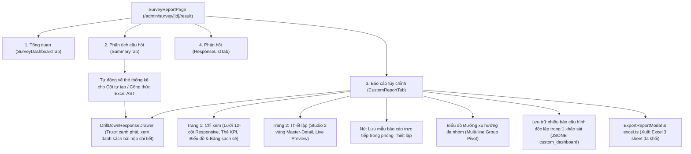

# ENTERPRISE SURVEY PLATFORM - FRONTEND CLIENT AGENT ENTRYPOINT

> **Phạm vi tài liệu:** Đây là file cổng chào (Router) cung cấp toàn bộ ngữ cảnh hệ thống, kiến trúc Frontend Next.js 16, tiến độ các tính năng báo cáo/phân tích, quy ước lập trình React 19 và danh mục tài liệu định tuyến cho Agent AI khi bắt đầu một phiên làm việc mới trên kho mã nguồn Client.
>
> Xem tài liệu tổng thể tại Backend repo: [D:/code/java/springboot/BE_KhaoSat/AGENTS.md](file:///D:/code/java/springboot/BE_KhaoSat/AGENTS.md)

---

## 1. TỔNG QUAN FRONTEND & THƯ VIỆN CỐT LÕI

- **Framework:** Next.js 16 (App Router, Turbopack)
- **UI & State:** React 19, Tailwind CSS v4, Lucide React
- **Biểu đồ & Trực quan hóa:** Apache ECharts 6 (`echarts`, `EChartsContainer.tsx`)
- **Kéo thả & Bảng biểu:** DnD Kit (`@dnd-kit/core`), ExcelJS (`exceljs`), Lucide React
- **Port:** `http://localhost:3000`
- **Tầng kết nối API:** `src/lib/api.ts` kết nối tới Spring Cloud Gateway tại `http://localhost:8080/api`.

---

## 2. CẤU TRÚC PHÂN HỆ BÁO CÁO (`src/components/result/`)



### Các tệp quan trọng trong `src/components/result/report-builder/`:
- `CustomReportTab.tsx`: Tab Báo cáo tùy chỉnh chính, quản lý 2 subpage (`view` và `setup`), thanh công cụ header có nút Lưu thay đổi / Lưu bản sao / Lưu mẫu, và danh sách khối widget.
- `ResultChartView.tsx`: Trực quan hóa ECharts, hỗ trợ cột nhóm, cột chồng, thanh ngang, donut, boxRange, và đặc biệt là **Đường xu hướng đa nhóm (Multi-line Group Pivot)**.
- `BuilderConfigPanel.tsx`: Cấu hình Gom nhóm 0..3 cấp, các phép đo lường (`count`, `% Total`, `avg`, `median`, `min`, `max`, `stddev`, `p90`), tùy chọn bảng chéo Pivot.
- `FilterBuilderBar.tsx`: Cấu hình cây bộ lọc đệ quy AND/OR trên bất kỳ câu hỏi, hàng ma trận, trường hệ thống hay cột công thức.
- `DashboardWidgetRenderer.tsx`: Bộ hiển thị khung cho từng widget card (KPI, Chart only, Table only, Chart & Table).
- `ExportReportModal.tsx` & `src/lib/report-export/excel.ts`: Xuất Excel 3 sheet (`Tong_quan`, `Tong_hop_cac_khoi`, `Du_lieu_chi_tiet`).
- `src/lib/report-engine/formula/`: Bộ thông dịch công thức Excel AST thuần (Lexer, Parser, Evaluator) an toàn, không dùng `eval`.

---

## 3. QUY TẮC LẬP TRÌNH BẮT BUỘC (CRITICAL RULES)

1. **Tránh lỗi React `setState` trong render:**
   - Khi component con cần kích hoạt callback của component cha (như `onChangeDashboardDef`), **tuyệt đối không** gọi bên trong hàm updater của `setDashboardDef((prev) => { onChange(next); return next; })`.
   - **Luôn bọc trong `queueMicrotask(() => { onChange(next); });`**.
2. **Tiền tố tên câu hỏi khi có nhiều trang:**
   - Luôn sử dụng hàm `getQuestionPrefixedLabel(q)` trong `extractors.ts` để hiển thị `[Tên trang] Tên câu hỏi` khi khảo sát có từ 2 trang trở lên, tránh trùng lặp hiển thị.
3. **Multi-line Group Pivot:**
   - Khi `chart.type === "line"` và tồn tại `output.pivotMatrix`, trục hoành là `p.rowKeys`, các đường là `p.colKeys`, và tooltip sử dụng `axisPointer: { type: "line" }`.
4. **Drill-down:**
   - Khi nhấp điểm dữ liệu trên biểu đồ đa đường, lấy danh sách `recordIds` từ `p.cells[rk]?.[ck]?.recordIds` để mở `DrillDownResponseDrawer`.

---

## 4. LỆNH KIỂM TRA & XÁC THỰC

```powershell
# Chạy toàn bộ 19 unit tests (100% pass)
npx vitest run

# Kiểm tra lint
npx eslint src/components/result/report-builder/CustomReportTab.tsx src/components/result/report-builder/ResultChartView.tsx

# Kiểm tra biên dịch Next.js production
npm run build
```
